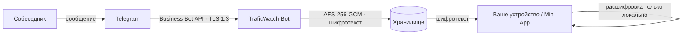

# TraficWatch
> Сообщение удалили. У вас оно осталось.
TraficWatch — сервис-архив для Telegram: сохраняет сообщения, историю правок и медиа
в подключённых чатах, присылает уведомления об удалениях и показывает статистику.
Архив хранится в зашифрованном виде, а ключ есть только у вас.

> **О репозитории.** Здесь лежит только документация сервиса. Исходный код бота,
> Mini App и инфраструктуры закрыт; cryptography-спецификация предоставляется по запросу.
---
## Содержание
- [Зачем это нужно](#зачем-это-нужно)
- [Возможности](#возможности)
- [Как устроено шифрование](#как-устроено-шифрование)
- [Чего сервис не делает](#чего-сервис-не-делает)
- [Подключение](#подключение)
- [Команды](#команды)
- [Ограничения](#ограничения)
- [FAQ](#faq)
- [Roadmap](#roadmap)
- [Контакты](#контакты)
---
## Зачем это нужно
В Telegram любой участник переписки может удалить сообщение «для обоих» — оно исчезает
из облака и с ваших устройств. Восстановить его штатными средствами нельзя: ни
«Избранное», ни экспорт истории, ни Telegram Premium этого не умеют.
TraficWatch работает как фоновый архиватор: пока вы общаетесь как обычно, сервис
сохраняет входящие сообщения и их изменения. Если собеседник удалит сообщение или
отредактирует его, вы получите уведомление с исходным текстом.
**Кому это нужно:**
- тем, кто ведёт переговоры, сделки и договорённости в Telegram;
- тем, кто получает документы, реквизиты и файлы в чатах;
- тем, кто сталкивается с мошенниками и хочет сохранить доказательства;
- тем, кто просто не хочет терять важное из-за чужой кнопки «удалить».
---
## Возможности
| Функция | Что делает |
|---|---|
| **Удалённые сообщения** | Если сообщение сохранилось до удаления, оно остаётся в архиве; приходит уведомление |
| **История правок** | Видно, что было написано до редактирования и что стало после |
| **Медиа** | Фото, видео, файлы и голосовые сохраняются вместе с текстом |
| **Одноразовые сообщения** | Сохранение фото/видео/голосовых «просмотр один раз» — ответом на сообщение |
| **Поиск** | Поиск по сохранённым диалогам в Mini App |
| **Статистика** | Удаления и правки за неделю, месяц или всё время — «контроль угроз» |
| **Mini App** | Архив, поиск и настройки прямо внутри Telegram, без отдельного приложения |
### Дополнительно
- **Антискам.** `/check @username` — карточка пользователя; `.report` — жалоба в базу;
  если вам пишет аккаунт из базы мошенников, бот предупредит автоматически.
- **Серии 🔥.** После 3 дней общения подряд появляется серия; пропуск дня замораживает
  её ❄️ (3 автоматические заморозки, 24 часа на разморозку), после четвёртого — сгорает.
- **Статусы.** `.online` — постоянный онлайн, `.act` — «печатает» / «ищет геопозицию».
- **Бытовые команды.** `.voice` (голос → текст), `.remind`, `.translate`, `.weather`,
  `.calc`, `.wordle`, скачивание медиа по ссылке.
---
## Как устроено шифрование
Главный принцип: **сервер хранит только шифротекст**. Ключ выводится на вашем
устройстве из парольной фразы и на сервер не передаётся — поэтому прочитать архив
без вас нельзя, даже имея полный доступ к базе.

**Схема в деталях:**
1. **Транспорт.** Обмен между Telegram, ботом и Mini App идёт по TLS 1.3.
2. **Ключ.** При первом входе в Mini App вы задаёте парольную фразу. Из неё на
   устройстве выводится ключ шифрования (Argon2id: память 64 МБ, 3 итерации,
   соль на аккаунт). Ключ живёт в памяти вкладки и в защищённом хранилище браузера —
   на сервер он не отправляется никогда.
3. **Запись.** Каждый объект архива шифруется на устройстве AES-256-GCM
   (уникальный nonce на запись). На сервер уходит конверт: шифротекст, nonce и
   метаданные, не раскрывающие содержимого.
4. **Чтение.** Mini App запрашивает конверт и расшифровывает его локально.
   Поиск выполняется по расшифрованным данным на устройстве.
5. **Удаление.** Удаление архива означает удаление конвертов и ключа-обёртки;
   без парольной фразы конверты не восстанавливаются.
### Что это значит на практике
- **Ваш архив не виден никому, кроме вас.** Ни третьим лицам, ни нам — без вашей
  ключевой фразы.
- **Утечка базы не раскрывает переписку.** В базе нет открытого текста, а ключа там нет.
- **Смена парольной фразы** перевыпускает ключ-обёртку: старый ключ перестаёт
  подходить, конверты перешифровываются.
### Честные границы заявления
Мы **не** называем это сквозным шифрованием (E2E) переписки в Telegram. Сообщения
боту доставляет Telegram, поэтому в момент сохранения сервис технически обрабатывает
содержимое, чтобы зашифровать его. Гарантия другая и конкретная: **после шифрования
открытый текст не сохраняется и не логируется**, а хранилище и резервные копии
содержат только шифротекст. Это проверяемое свойство, а не обещание «мы честные».
---
## Чего сервис не делает
- **Не просит пароль от Telegram и код входа.** Подключение — только через штатную
  «Автоматизацию чатов» Telegram Business.
- **Не создаёт сессию вашего аккаунта.** В «Устройствах» Telegram не появляется
  новых сеансов.
- **Не читает чаты, к которым вы не дали доступ.** Бот видит только то, что
  Telegram передаёт ему после подключения.
- **Не хранит открытый текст** сообщений после шифрования и не пишет содержимое в логи.
- **Не продаёт и не передаёт данные третьим лицам.** Удаление архива — по запросу
  на `traficwatch@enet-dev.ru`.
---
## Подключение
Нужен Telegram; **Premium не требуется**.
1. Откройте [@TraficWatchBot](https://t.me/TraficWatchBot) и нажмите «Start».
2. Скопируйте юзернейм бота.
3. Профиль → «Изменить» → **«Автоматизация чатов»**.
4. Вставьте `@TraficWatchBot` и сохраните.
Если в боте пришло сообщение «Бот подключён» — всё работает. Список команд — `.help`.
> Названия пунктов меню зависят от версии приложения. Подключение можно отозвать
> в любой момент там же, в «Автоматизации чатов»; уже сохранённый архив при этом
> остаётся, пока вы не удалите его отдельно.
---
## Команды
| Команда | Назначение |
|---|---|
| `.help` | Список всех команд |
| `/check @username` | Карточка пользователя, бота или канала |
| `.report` | Жалоба на мошенника или подозрительный аккаунт |
| `.online` | Постоянный статус «в сети» |
| `.act` | Статус «печатает» / «ищет геопозицию» в выбранных чатах |
| `.voice` | Расшифровка голосового в текст |
| `.remind 20m текст` | Напоминание |
| `.translate` | Перевод сообщения |
| `.weather` | Погода |
| `.calc` | Калькулятор |
| `.wordle [слово] [подсказка?]` | Игра «Вордли» |
Команды выполняются в ваших чатах и удаляются после выполнения.
---
## Ограничения
- **Архив начинается с момента подключения.** Сообщения, удалённые до подключения,
  восстановить нельзя — их у сервиса никогда не было.
- **Telegram не всегда присылает клиентам событие удаления.** Небольшая часть удалений
  может быть пропущена; для таких случаев остаётся сохранённая копия в архиве.
- **Ограничения Bot API.** Размер сохраняемых медиа ограничен API (порядка 20 МБ на
  файл при официальном Bot API; больше — только с собственным Bot API-сервером).
- **Расшифровка без ключа невозможна.** Если вы забыли парольную фразу и не сделали
  резервную копию ключа, архив не восстановить — это обратная сторона шифрования.
- **Сервис работает, пока в аккаунте включена «Автоматизация чатов».** Отключили бота —
  новые сообщения не сохраняются.
---
## FAQ
**Нужен ли Telegram Premium?**
Нет. Подключение идёт через «Автоматизацию чатов», Premium не требуется.
**Может ли TraficWatch прочитать мой архив?**
Хранилище содержит только шифротекст; ключ выводится на вашем устройстве из парольной
фразы и на сервер не передаётся. Без фразы прочитать конверты нельзя.
**Что будет, если базу украдут?**
Утечка даст шифротекст и метаданные (время, тип чата). Содержимое переписки — нет.
**Как удалить архив?**
Напишите на `traficwatch@enet-dev.ru`. Удаляются конверты, ключ-обёртка и резервные копии.
**Это официальный клиент Telegram?**
Нет, это сторонний сервис. Он не связан с Telegram и не влияет на работу приложения;
отключение — в настройках Telegram, в один шаг.
**Чем это отличается от «сохранить в Избранное»?**
«Избранное» требует ручного действия и не защищает от удаления. TraficWatch сохраняет
автоматически и показывает, что именно собеседник удалил или изменил.
---
## Roadmap
- [x] Архив удалённых сообщений и правок
- [x] Медиа и одноразовые сообщения
- [x] Mini App, поиск, статистика
- [x] Антискам-база, `/check`, `.report`
- [x] Серии 🔥 и заморозки ❄️
- [ ] Резервная копия ключа (фраза восстановления)
- [ ] Двухфакторная защита архива
- [ ] Экспорт архива в файл на устройстве
- [ ] Публичная спецификация шифрования
---
## Контакты
- Канал: [@TraficWatch](https://t.me/TraficWatch)
- Бот: [@TraficWatchBot](https://t.me/TraficWatchBot)
- Чат проекта: [@traficwatchat](https://t.me/traficwatchat)
- Сайт: [enet-dev.ru](https://enet-dev.ru/)
- Почта: `traficwatch@enet-dev.ru`
---
© TraficWatch. Документация репозитория распространяется по CC BY 4.0;
сервис и его код — проприетарные. Telegram — товарный знак Telegram FZ-LLC.
